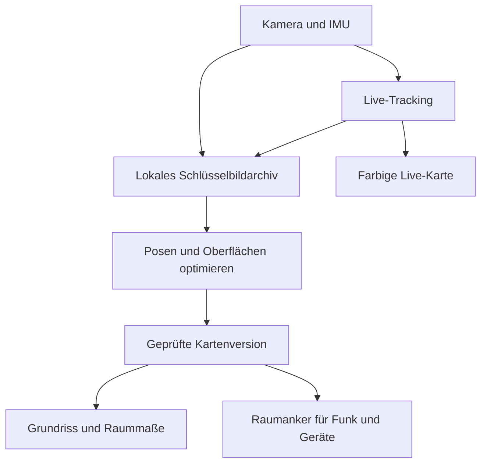

# RF Lab · Wohnungen mit dem Smartphone kartieren

**Technikbewertung und Entwicklungsroadmap · 19. November 2026**

**Empfehlung.** RF Lab sollte beim Rundgang auf dem Pixel 10 Pro XL sofort eine farbige Karte aufbauen und nach dem Scan auf demselben Gerät die Kameraposen, Wände und Raummaße nachrechnen. Das Konzept ist für Wohnungen tragfähig. Für die heutige Implementierung ist eine verlässliche Maßgenauigkeit noch offen. Bei ganzen Gebäuden kommen die Wiedererkennung von Räumen, die Verbindung von Etagen und die Verarbeitung langer Aufnahmen als eigene Entwicklungsaufgaben hinzu.

| Produktziel | Technisches Urteil | Nächster Nachweis |
| --- | --- | --- |
| Farbige Karte während des Gehens | Mit dem vorhandenen ARCore-Pfad als erste Produktfunktion realistisch. | Einen Raum umrunden, die Tür erneut anvisieren und auf dem Handy sehen, welche Wandflächen noch fehlen. |
| Korrekte Raummaße | Unter definierten Aufnahmebedingungen plausibel. Die zwei ausgewerteten Pixel-Scans liefern dafür keine unabhängige Referenz. | Blindvergleich mit Lasermaßen von 2–6 m. Pilotziel sind höchstens 5 cm Fehler im Median und 10 cm beim 90. Perzentil. |
| Wohnung und Gebäude | Eine Wohnung braucht einen dauerhaften Bezugsrahmen. Gebäude brauchen zusätzlich Teilkarten pro Etage und zuverlässige Übergänge. | Nach einem Neustart am bekannten Türdurchgang wieder einsteigen und einen zweiten Raum anfügen. |
| Funk und Smart Home | Raumerkennung mit eingemessenen Funkprofilen ist ein sinnvoller Anschluss. Die Nähe zu einer einzelnen Lampe verlangt einen eigenen Nachweis. | Zuerst den erkannten Raum protokollieren, danach eine zugeordnete Lampe im Heimnetz schalten. |

**Technologieentscheidung für die nächste Version.** ARCore liefert die Vergleichsbasis für Live-Tracking und metrisch skalierte Roh-Tiefe. OpenVINS bleibt der parallel prüfbare Tracking-Kandidat. Depth Anything 3 (DA3) ergänzt ausgewählte Schlüsselbilder. Ein Wechsel des Standardverfahrens hängt an denselben Raummaßen und Rundgängen auf dem Pixel. Die vorgesehene Aufnahme, Optimierung und Auswertung laufen ohne Cloud und ohne zusätzlichen Rechner im Haushalt. [ARCore Raw Depth][raw] · [Mobiler DA3-Export][da3] · [OpenVINS][ov]

**Erster Produktmeilenstein.** Eine Person scannt einen Raum samt Tür, schließt den Rundgang, legt das Handy kurz zur Seite und öffnet anschließend einen bemaßten Grundriss. Bei unzureichender Wandabdeckung zeigt die App genau die Stelle für eine Nachaufnahme. Die Rohdaten bleiben für eine erneute Auswertung erhalten.

## Was heute im Repository steckt

Der geprüfte App-Code auf `main` entspricht v0.5.0 (`d936c2f`). Die aktuelle 3D-Entwicklung liegt im offenen Entwurf PR #9 auf `feature/embedded-openvins-v1.3` (`d6004cc`). Der jüngste im Repository veröffentlichte private Teststand ist v1.3.8. Für den v1.3.9-Quellstand endete der überprüfte Release-Lauf vor der Runner-Zuteilung mit null ausgeführten Schritten. Damit stehen Build- und Pixel-Nachweis für die neuen Korrekturen aus. [Hauptzweig][main] · [Entwicklungsstand][pr] · [Testrelease][rel] · [Release-Lauf][ci]

| Bereich | Konkreter Befund | Bedeutung für die Weiterentwicklung |
| --- | --- | --- |
| ARCore-Livescan | RGB, Pose, Roh-Tiefe und Konfidenz sind vorhanden. Der Code fasst Punkte in 5-cm-Voxeln zusammen. Das Oberflächennetz entsteht aus einzelnen Tiefenbildern. | Aufnahme, Darstellung und Archiv übernehmen. Die Voxelgröße beschreibt die Darstellung. Die Messgenauigkeit muss am Raum nachgewiesen werden. |
| OpenVINS und DA3 | Echte native Kameraposen, Einzelbildbrowser und farbige Gesamtansicht sind vorhanden. Ohne belastbare Tiefenanpassung verteilt die Diagnose relative Tiefe auf ein festes Anzeigeintervall. | Die Gesamtansicht hilft bei der Fehlersuche. Nur geometrisch gestützte Daten dürfen in Raummaße und dauerhafte Anker eingehen. |
| Bildabgleich | Der Matcher vergleicht ein Schlüsselbild mit bis zu drei folgenden Bildern. Der Überlappungstest sucht nahe Punkte aus einem anderen Foto mit Standardradius 0,16 in der verwendeten Kartenkoordinate. | Das prüft lokale Übereinstimmung. Langstreckige Wiedererkennung, globale Posenkorrektur und ein unabhängiger metrischer Fehlernachweis fehlen. |
| Speicherung und Grundriss | Das ARCore-Archiv begrenzt einen Scan auf 180 Schlüsselbilder und 320 MiB. Der Punktspeicher hat 80.000 Plätze. Seine Anzeigegrenzen sind Koordinatenextrema, Räume bislang achsenparallele Rechtecke. | Für längere Rundgänge braucht es segmentierte Aufnahmen, echte Wandpolygone und stabile Raum-IDs über mehrere Sitzungen. |
| Funk und Automationen | RF Lab verwirft alte WLAN-Ergebnisse, bewertet gemeinsame BSSIDs und kennt „Unbekannt“. Geräte und Regeln lassen sich Räumen zuordnen. Alexa erzeugt bisher Testnachrichten. | Raummodell und Simulator weiterverwenden. Aus dem angezeigten Konfidenzwert lässt sich bisher keine empirische Trefferquote ableiten. |

**Konkrete Korrektur für den nächsten Test-Build.** Der v1.3.9-Workflow benennt die APK nach dem Release. Im geprüften Gradle-Stand steht intern noch `1.3.2-openvins-init-diagnostics-dev`. Versionsname, Build-Commit und Kalibrierprofil gehören gemeinsam in Diagnose und Export, damit Vorher/Nachher-Vergleiche eindeutig bleiben. [Gradle-Konfiguration][gradle] · [Release-Workflow][wf]

Quellcode · [RGB-D-Erfassung][rgb] · [Voxelgrenzen][voxel] · [Anzeigegrenzen][bounds] · [Archiv][archive] · [Oberflächennetz][mesh] · [Mehrbildabgleich][matcher] · [Überlappungstest][overlap] · [Diagnosekarte][world] · [Raummodell][home] · [Lokalisierung][locator]

## Was die beiden Pixel-Aufnahmen zeigen

Die beiden Auswertungsdateien vom 19. November enthalten dieselben zwei Aufnahmen vom 18. November. Die folgende Tabelle zählt jeden Lauf einmal. „Mit Pose“ bezeichnet ein Foto innerhalb von 180 ms zur nächsten VIO-Pose im Archivbenchmark. Die Bildkennzahlen beziehen sich auf diese zugeordneten Fotos.

| Messwert | Heller Lauf · 07:24 | Dunkler Lauf · 22:03 |
| --- | ---: | ---: |
| Dauer und native Posen | 15,984 s · 462 | 20,143 s · 303 |
| Median des Posenabstands | 33,3 ms | 66,7 ms |
| Fotos mit Pose / alle Fotos | 18 / 32 | 21 / 40 |
| Helligkeit · Median auf einer Skala bis 255 | 127,5 | 6,0 |
| ORB-Bildmerkmale · Median | 1.000 (Obergrenze der Auswertung) | 148 |
| Geschätzte Pfadlänge · native Einheiten | 1,005 | 87,169 |
| Abstand zwischen Start und Ende · native Einheiten | 0,024 | 75,631 |

Im dunklen Lauf hatten 20 von 21 zugeordneten Fotos einen Grauwertmedian unter 50. Trotzdem gab es in beiden Läufen kein Posenintervall über 100 ms. **Eine laufende Positionsanzeige allein reicht folglich nicht als Qualitätsnachweis.** ORB zählt hier Bildmerkmale im gespeicherten JPEG. Die Zahl misst weder die Anzahl der vom VIO-Filter verwendeten Inlier noch die Genauigkeit der Bewegung. Die tatsächlichen Wege sind unbekannt. Beide Exporte nennen `PRIMARY_CAMERA` als Bezug. Der räumliche Versatz zum Gyroskop und der Zeitversatz zwischen Kamera und IMU sind unabhängig noch zu bestimmen. [Archivvergleich im Projekt][pr]

### Drei Versuche für die beobachtete Wölbung

1. **Einzelbild isolieren.** Dieselbe ebene Wand bei bekannten Abständen frontal und schräg, mit festem Objektiv und vermessenen Markierungen aufnehmen. Tiefenrichtung des konkreten DA3-Exports, optische Z-Tiefe gegenüber Strahllänge, Rotation, Crop, Brennweite und Verzeichnung einzeln prüfen. Residuen nach Bildmitte und Rand ausgeben. Eine Wölbung im einzelnen Kamerabild kann bereits vor der Posenfusion entstehen.
2. **Kamerabewegung isolieren.** Nach der Initialisierung im Stand, auf markierter gerader Strecke und auf einer geschlossenen Runde messen. Belichtung, Bildrate, Zeitversatz und tatsächlich verwendete Merkmale dokumentieren. Helle und dunkle Wiederholung auf derselben Strecke zeigen, ob der Trackingfehler mit der Sichtbarkeit wächst.
3. **Zusammenführung isolieren.** Dieselben Schlüsselbilder mit festen Posen und jeweils nur einer Tiefenquelle erneut rechnen. Ist ein Einzelbild eben und entstehen erst im Verbund Doppelwände, zuerst Pose, Zeitzuordnung und relative Tiefenskala prüfen. Der v1.3.9-Code nimmt die frühere Kehrwertbildung für diese direkte relative Tiefe zurück und interpoliert Posen auf den Bildzeitpunkt. Die Wirkung auf dem Pixel ist offen. [Geometriekorrekturen][geometry] · [Modellkarte][da3]

## So entsteht die Karte auf dem Smartphone

Während der Aufnahme zählt eine ruhige, zeitnahe Anzeige. Nach dem Rundgang kann das Smartphone dieselben Schlüsselbilder erneut auswerten, korrigierte Posen verwenden und eine neue Kartenversion speichern. Ein lokal gespeichertes Aufnahmeformat verbindet die beiden Rechenwege.

**Beim Gehen.** Ein Trackingverfahren führt die Kamera pro Sitzung. Der Live-Pfad zeichnet Posen, farbige lokale Flächen und erfasste Wandabschnitte. Die App gibt konkrete Hinweise wie „Türrahmen noch einmal aus der Gegenrichtung ansehen“. Bei Trackingverlust friert die gültige Teilkarte ein. Neue Punkte fließen nach erfolgreicher Wiedererkennung oder in eine neue Teilkarte ein.

**Nach dem Scan.** Die App erkennt überlappende Schlüsselbilder, prüft ihre geometrische Übereinstimmung und schließt Rückwege im Posengraphen. Ein lokaler Bündelausgleich verfeinert Kameraposen und gemeinsame Bildpunkte. Erst danach integriert die App Tiefenbilder mit ihrer Konfidenz erneut in Teilkarten, beispielsweise mit einem TSDF-Volumen. Widersprüche an Tiefensprüngen und bewegten Gegenständen werden ausgesondert. [Posengraph und Registrierung][graph] · [Volumetrische Tiefenfusion][tsdf]

**Was dauerhaft gespeichert wird.** Jede Sitzung hält RGB-Schlüsselbilder, Sensorzeiten und Zeitbasis, Kameramodell, Kalibrierprofil, Pose samt Bezugssystem und die verfügbaren Tiefen- oder IMU-Daten fest. Jede abgeleitete Karte erhält eine Version. Zimmer, Türen, Funkmessungen und Geräte referenzieren stabile IDs und lokale Anker. Nach einer Posenkorrektur werden ihre Koordinaten gemeinsam neu berechnet. Vor dem Ersetzen einer Karte wird die neue Version vollständig geschrieben.

**Rechenlast.** Tracking erhält Vorrang. DA3 läuft auf ausgewählten Schlüsselbildern, die Optimierung abschnittsweise mit fortsetzbaren Zwischenständen. Bei Wärme oder Speicherdruck senkt die App die Vorschauauflösung und verschiebt dichte Verarbeitung bis nach dem Scan. Der DA3-Anbieter nennt rund 1,8 s pro Bild auf einem Pixel 8a. Die Inferenzzeit auf dem Pixel 10 Pro XL wird separat gemessen. Scannen, Wiederöffnen und Bemaßen gehören in einen Flugmodus-Test auf dem eingerichteten Pixel. [DA3-Modellkarte][da3] · [Android-Thermalsignale][thermal]

## Wie aus einer Punktwolke Raummaße werden

**Live-Tracking wählen.** ARCore ist kurzfristig die günstigste Referenz, weil die App dafür bereits Posen, Farbbilder und Roh-Tiefe mit Konfidenz speichert. Schwach strukturierte Wände können Lücken zeigen. OpenVINS bietet Zugriff auf die Schätzung von Kamera und IMU und erlaubt eine genauere Fehleranalyse. Ein Standardwechsel setzt im Pixel-Vergleich bessere oder gleichwertige Raummaße und eine stabile Live-Anzeige voraus. [Google Raw Depth][raw] · [OpenVINS und Erweiterungen][ov]

| Option | Rolle im nächsten Aufbau | Entscheidungskriterium |
| --- | --- | --- |
| ARCore mit Roh-Tiefe | Erster Live-Pfad. Unsichere Flächen bleiben sichtbar offen. ARCore-Posen sind Startwerte für die eigene Offline-Karte. | Blindmaße, Abdeckung und Rückkehr zum Türrahmen auf dem Pixel. |
| OpenVINS mit Kartenoptimierung | Kontrollierbarer zweiter Trackingpfad. Intrinsik für genau das Objektiv, Kameralage zur IMU, Zeitversatz und IMU-Rauschen mit separater Kalibriersequenz bestimmen. | Reprojektion auf unabhängigen Aufnahmen, Drift und Maßstabilität bei wechselndem Licht. |
| DA3 und optische Mehrbildtiefe | DA3 als relative Tiefeninformation einsetzen. Maßstab und Versatz an metrischer Tiefe oder gut triangulierten Punkten mit geprüftem Maßstab festlegen. | Gegen zurückgehaltene Tiefenpunkte und Wandmaße testen. Nur bei messbarem Zusatznutzen mehr DA3-Flächen übernehmen. |
| ORB-SLAM3 als Vergleich | Bei anhaltender Drift denselben Rohdatensatz mit einem Verfahren mit Schleifenschluss und mehreren Teilkarten auswerten. | Eine Android-Portierung erst priorisieren, wenn der Vergleich Fehler senkt und Laufzeit sowie Speicher auf dem Telefon plausibel sind. |

Das Pixel-Profil entsteht einmalig in der Entwicklung. Der Schachbretttest prüft die Kamera. Eine AprilGrid-Sequenz mit synchronen Bewegungen in mehreren Achsen sowie unabhängige Testbilder prüfen das Zusammenspiel mit der IMU. Der Nutzer kann anschließend direkt mit dem Handy scannen. [Kalibrierverfahren][kal] · [ORB-SLAM3][orb]

**Alternative für die Tiefe.** Die DA3-Modellfamilie kann mehrere Bilder und bekannte Posen gemeinsam verarbeiten. Der eingebaute LiteRT-Export sieht pro Aufruf ein Bild. Eine echte Mehrbildvariante auf denselben Wandaufnahmen gegen Roh-Tiefe und Einzelbild-DA3 testen. Über eine Portierung entscheiden Fehlergewinn, Laufzeit und Spitzenbedarf an Speicher. [DA3-Mehrbildmodell][da3multi] · [LiteRT-Export][da3]

**Grundriss ableiten.** In der optimierten Punktwolke Boden, Decke und Wandinnenflächen mit mehrfacher Sicht bestimmen. Länge und Breite ergeben sich aus den Wandinnenflächen, Raumhöhe aus Boden und Decke. Schrägwände, Nischen und L-förmige Räume als Polygone behalten. Für jede angezeigte Maßlinie die beteiligten Flächen, deren Abdeckung und Streuung speichern. Wo Möbel die Wand verdecken, eine Nachaufnahme oder eine klar gekennzeichnete manuelle Ergänzung anbieten.

**Mehrere Räume und Etagen.** Überlappende Türdurchgänge verbinden Teilkarten. Treppenpodeste verbinden Etagen im Gebäudemodell. Die App versieht bestätigte Übergänge mit geometrischen Referenzen. Bei mehrdeutigen Türen fordert sie einen weiteren Blick an. So kann ein späterer Scan einen Raum ergänzen, ohne bestehende Funkanker oder Geräte zu versetzen.

## Woran wir die nächste Version abnehmen

Alle Schwellen in diesem Abschnitt sind **vorgeschlagene Produktziele**. Die vorhandenen Läufe weisen sie nicht nach. Der Pilot wird auf dem Pixel 10 Pro XL zunächst mit einer festgelegten Hauptkamera und ohne Cloud durchgeführt.

| Prüfung | Versuchsaufbau | Angestrebte Abnahme |
| --- | --- | --- |
| Live-Karte | 10 Minuten mit hellen und dunkleren Abschnitten, Türdurchgang und absichtlicher Trackingunterbrechung. | Mindestens 20 Posen/s im regulären Tracking, P95 der Pose-bis-Anzeige-Latenz höchstens 150 ms, sichtbare Kartenaktualisierung mindestens 2 Hz. Ausfälle gesondert zählen. |
| Maßhaltigkeit | Mindestens 30 unabhängige Innenmaße von 2–6 m in mindestens fünf Räumen und zwei Grundrissen. Jeden Rundgang dreimal neu starten. Länge, Breite und Höhe getrennt berichten. | Median des absoluten Fehlers höchstens 5 cm, P90 höchstens 10 cm. Mindestens 90 % der vorgesehenen Maße automatisch ausgeben. Fehlende Maße mitzählen. Türbreiten für passgenaue Einbauten benötigen eine engere, eigene Abnahme. |
| Ebene und Maßstab | Markierte, vermessene Wand von mehreren Blickrichtungen erfassen. Separat eine bekannte 1-m-Translation und eine 90°-Drehung nach der Initialisierung aufzeichnen. | P95 des senkrechten Wandfehlers höchstens 3 cm auf der sichtbaren Referenzfläche. Mitte/Rand und Lagefehler ausweisen. Eine im Fit genutzte Marke zählt hier nicht zur Prüfung. |
| Rückkehr und Neustart | Rundgang von 20–40 m über zwei Räume. Rohfehler am Startpunkt vor der Korrektur erfassen. Zehn Neustarts an bekannten Stellen, darunter ähnliche Türen. | Nach Optimierung P90 höchstens 10 cm an unabhängigen Kontrollpunkten. Mindestens 9/10 richtige Wiederaufnahmen, keine falsch akzeptierte Verknüpfung in diesem Pilot. |
| Rechnen auf dem Gerät | Zehnminütigen Scan lokal optimieren. Laufzeit, Peak-Speicher, Wärme, verworfene Schlüsselbilder und Archivgröße erfassen. Optimierung einmal unterbrechen. | Richtwert für die Nachrechnung höchstens 20 Minuten. Wiederanlauf erzeugt dieselbe vollständige Karte innerhalb der gemessenen Wiederholstreuung. Aufnahme bleibt bedienbar. |

**So bleibt der Vergleich aussagekräftig.** Laser- oder Bandmaß-Endpunkte vorab markieren und doppelt messen. Kalibriermaße sowie zur Skalierung verwendete Distanzen getrennt von den Prüfmaßen halten. ARCore und OpenVINS möglichst auf denselben Bildern vergleichen. Wo das Geräte-API unterschiedliche Eingänge erzwingt, dieselbe markierte Route unter gleicher Beleuchtung wiederholen und als gepaarten Feldversuch ausweisen. ARCore-Wiedergabe kann zwischen Läufen unterschiedlich ausfallen. [ARCore-Aufnahme und Wiedergabe][replay]

**Entscheidungsregel.** P90 bzw. P95 bezeichnet die Grenze, unter der 90 bzw. 95 % der beobachteten Werte liegen. Fehler je Raum, Fehlversuche und Abdeckung berichten. Beim Trajektorienvergleich den metrischen Maßstab festhalten, damit ein freier Skalierungsfaktor den Maßfehler nicht verdeckt. Wird ein Ziel verfehlt, bleibt der betreffende Messmodus als Vorschau verfügbar. Erst wenn der Versuch an einem weiteren Aufnahmeort gelingt, erweitert sich die Freigabe auf diesen Einsatzbereich.

## Funkkartierung und Smart Home im selben Grundriss

**Funkkarte einmessen.** Nach dem Bestätigen der Räume führt die App zu Messpunkten in Raummitte, an Übergängen und in schwierigen Ecken. Sie speichert frische WLAN-Signalstärken pro BSSID und Frequenz mit Messzeit, Raum-/Teilkarte, Pose und Ausrichtung. Unterschiedliche Orientierungen und Tageszeiten erfassen. Bei späterer Kartenoptimierung wandern die Messpunkte mit ihren Ankern. Die Heatmap zeigt gemessene Abdeckung und unterbricht die Interpolation an Wänden und in unbeobachteten Bereichen.

| Funktion | Sinnvoller erster Umfang | Praktische Grenze |
| --- | --- | --- |
| Handy einem Raum zuordnen | Eingemessene WLAN-Fingerprints mit einem einfachen Nachbarschaftsverfahren vergleichen. Zimmerwechsel nur entlang begehbarer Übergänge bewerten. BLE oder Magnetfeld erst nach gemessenem Zusatznutzen ergänzen. | Lückenhafte oder gealterte Daten ergeben „Unbekannt“. Zimmerposition bezieht sich auf das mitgeführte Handy. |
| Nähe zu Lampen oder Steckdosen | Gerät einer Stelle auf dem Grundriss und einer steuerbaren Geräte-ID manuell zuordnen. Für zwei Geräte im selben Zimmer die Positionsunsicherheit mit dem Abstand der Geräte vergleichen. | Ein gewöhnliches WLAN-Gerät liefert dadurch keine eigene Distanzmessung. Bei überlappenden Unsicherheitsbereichen ist eine Raumregel sinnvoller. |
| Optionale Distanzmessung | Wi-Fi RTT mit kompatiblen, vermessenen Access Points testen. UWB für gezielte Nähe zu kompatiblen Gegenstellen vorsehen. | Normale RSSI-Scans liefern keinen belastbaren Zentimeterabstand. Im Heimnetz mit FRITZ!Box 7590 und ASUS XD4 Plus zuerst die tatsächlich gemeldeten RTT-Gegenstellen erfassen. Der Pilot funktioniert mit RSSI-Fingerprints. |
| Tatsächlich schalten | Zunächst die Entscheidung protokollieren. Danach eine freigegebene Testlampe über einen optionalen lokalen Home-Assistant-Adapter schalten. | Verweildauer, Hysterese, Ereignis-ID und Rückmeldung verhindern unnötige Wiederholungen. Bei „Unbekannt“ oder altem Scan pausiert die Regel. Alexa bleibt eine spätere, ausdrücklich gewählte Integration. |

**Entscheidend für das Alltagserlebnis ist die Latenz.** Android begrenzt selbst angeforderte WLAN-Scans unter Standardbedingungen auf vier in zwei Minuten je Vordergrund-App und einen in 30 Minuten für alle Hintergrund-Apps zusammen. Zusätzlich empfangene Systemscans haben keinen garantierten Takt. Für „Licht beim Eintreten“ mit gesperrtem Handy daher einen unabhängigen Raumsensor oder geeignete lokale Präsenzinfrastruktur separat testen. Die Gebäudeaufnahme bleibt davon unabhängig. [Android-Scanlimits][wifi] · [Wi-Fi RTT][rtt] · [UWB-Gegenstellen][uwb]

**Pilot für eine Wohnung.** An mindestens zwei getrennten Tagen trainieren und an einem weiteren Tag blind testen. Pro Raum Treffer, Verwechslungen und „Unbekannt“ ausweisen. Ziel im Vordergrund sind Macro-F1 ≥ 0,90 über die Räume und mindestens 80 % entscheidbare Beobachtungen. Ein „Unbekannt“ bei bekanntem Raum zählt als verpasster Treffer. Als erstes Ziel für den WLAN-Piloten gilt eine P90-Wechselzeit von höchstens 60 s. Für sofortiges Licht gilt ein separates Ziel von höchstens 2 s mit geeignetem Auslöser. Vor echtem Schalten 50 protokollierte Wechsel mit höchstens einer falschen Auslösung sowie einen Versuch mit gesperrtem Display auswerten. Der lokale Adapter erhält nur Raumereignis und Geräte-ID. [Implementierte Raumlogik][locator] · [Home Assistant][ha] · [Alexa-Prototyp][alexa]

## Roadmap und nächste Iteration

Die Aufwandsspannen sind grobe Planwerte in Personenwochen (PW) für eine erfahrene Android-/Computer-Vision-Entwicklung mit Zugang zum Pixel und zu Testwohnungen. Die Messergebnisse entscheiden über den jeweils nächsten Ausbau. Eine Zusammenführung der bisherigen Entwicklungszweige ist dafür gesondert zu testen.

| Etappe und Aufwand | Liefergegenstand | Entscheidung am Ende |
| --- | --- | --- |
| M0 · Testbasis · 0,5–1 PW | v1.3.9 reproduzierbar bauen, Commit in der App anzeigen, Referenz-APK v1.3.8 und beide Archivläufe vergleichen. | Installierbare Pixel-Version, eindeutige Diagnose und reproduzierbare Auswertung. Bei blockiertem Runner den vorhandenen lokalen Android-Build nutzen. |
| M1 · Optik und Tracking · 1–2 PW | Pixel-Profil und Zeitversatz prüfen. Wand-, Strecken- und Rückkehrversuche mit ARCore und OpenVINS durchführen. | Live-Standard anhand der Zahlen wählen. Bleibt OpenVINS instabil, trägt ARCore die nächste Etappe und OpenVINS bleibt im Vergleich. |
| M2 · Ein Raum live · 2–4 PW | Farbige Vorschau, Abdeckungsanzeige, Hinweise für die Aufnahme, lokale Schlüsselbilder und Wiederaufnahme nach kurzem Verlust. | Zehnminütiger Rundgang erfüllt die Live-Ziele. Lücken sind sichtbar und lassen sich gezielt nachscannen. |
| M3 · Optimierter Grundriss · 3–5 PW | Schleifenschluss, begrenzter Bündelausgleich, erneute Tiefenfusion und Maße aus Wandflächen auf dem Handy. | Blindmaße und Wandtest bestehen. Bei Wölbung den fehlerhaften Anteil aus Pose oder Tiefe mit den drei Isolationsversuchen bestimmen. |
| M4 · Wohnung und Gebäude · 3–6 PW | Räume an Türen verbinden, Karte über Neustarts fortsetzen, Teilkarten pro Etage mit Treppenübergang. | Zuerst Wohnung mit Flur und mindestens drei Räumen abnehmen, anschließend zwei Etagen separat prüfen. Raum-IDs bleiben nach Nachscan stabil. |
| M5 · Funk und Lokalisierung · 2–4 PW | Geführte Referenzpunkte und Funkkarte je BSSID. Kamerafreier Raumwechseltest im Vordergrund und mit gesperrtem Handy. | Tagesübergreifende Trefferquote, Abdeckung und Wechselzeit berichten. Der Wohnungspilot kann nach der Ein-Etagen-Abnahme aus M4 beginnen. |
| M6 · Lokale Automationen · 1–3 PW | Simulator mit realen Wechseln prüfen, danach eine Lampe über Home Assistant anbinden. | Pilotgrenze für Fehltrigger bestehen. Latenz für den gewählten Auslöser auf dem tatsächlichen Gerät ausweisen. |

**Die ersten zehn Arbeitstage.** Zuerst die Version eindeutig baubar machen und die beiden Archive mit demselben Auswerteskript wiedergeben. Danach eine gerade Wand mit Referenzebene, eine gemessene Strecke und einen Rundgang bei gutem sowie schwachem Licht aufnehmen. Ziel am zehnten Arbeitstag sind eine Fehlerübersicht je Tracker, die gemessene zeitliche Stabilität und eine Entscheidung über den Standardpfad für den ersten Raum. Bei ausstehender Kalibrierung werden die betroffenen Ergebnisse als offen geführt.

**Planungspunkt.** M0 bis M3 ergeben als erste Schätzung rund 7–12 PW bis zum bemaßten Einzelraum-Piloten. Die belastbare Entscheidung über ein Gebäudemapping fällt nach den Wiederaufnahme- und Etagentests, die über reale Schaltfunktionen nach den Funkversuchen im Haushalt. [Vorhandener lokaler Buildpfad][localbuild] · [Offener Buildvorgang][blocker]

[main]: https://github.com/groegberg/rf-lab-android/tree/d936c2f6aabb6673e636b5420d39da652cdea3c4
[pr]: https://github.com/groegberg/rf-lab-android/pull/9
[rel]: https://github.com/groegberg/rf-lab-android/releases/tag/v1.3.8-openvins-allframes-worldmap-private-test.1
[ci]: https://github.com/groegberg/rf-lab-android/actions/runs/44516617016
[blocker]: https://github.com/groegberg/rf-lab-android/issues/11
[gradle]: https://github.com/groegberg/rf-lab-android/blob/d6004cc0e9c412275bff7245eb00e1dee565e529/app/build.gradle.kts#L19-L20
[wf]: https://github.com/groegberg/rf-lab-android/blob/d6004cc0e9c412275bff7245eb00e1dee565e529/.github/workflows/publish-v1.3.9-private-geometry-calibration-qa.yml
[rgb]: https://github.com/groegberg/rf-lab-android/blob/d6004cc0e9c412275bff7245eb00e1dee565e529/app/src/main/java/dev/rflab/scanner/RgbdSampler.kt
[voxel]: https://github.com/groegberg/rf-lab-android/blob/d6004cc0e9c412275bff7245eb00e1dee565e529/app/src/main/java/dev/rflab/scanner/VoxelFusion.kt#L5-L15
[bounds]: https://github.com/groegberg/rf-lab-android/blob/d6004cc0e9c412275bff7245eb00e1dee565e529/app/src/main/java/dev/rflab/scanner/RoomScanStore.kt#L122-L136
[archive]: https://github.com/groegberg/rf-lab-android/blob/d6004cc0e9c412275bff7245eb00e1dee565e529/app/src/main/java/dev/rflab/scanner/RgbdKeyframeArchive.kt
[mesh]: https://github.com/groegberg/rf-lab-android/blob/d6004cc0e9c412275bff7245eb00e1dee565e529/app/src/main/java/dev/rflab/scanner/RgbdSurfaceMesher.kt
[matcher]: https://github.com/groegberg/rf-lab-android/blob/d6004cc0e9c412275bff7245eb00e1dee565e529/app/src/main/java/dev/rflab/scanner/OpenVinsDa3MultiView.kt#L123-L150
[overlap]: https://github.com/groegberg/rf-lab-android/blob/d6004cc0e9c412275bff7245eb00e1dee565e529/app/src/main/java/dev/rflab/scanner/OpenVinsMultiViewAgreement.kt#L27-L87
[world]: https://github.com/groegberg/rf-lab-android/blob/d6004cc0e9c412275bff7245eb00e1dee565e529/app/src/main/java/dev/rflab/scanner/OpenVinsDa3DiagnosticWorld.kt#L45-L87
[home]: https://github.com/groegberg/rf-lab-android/blob/d6004cc0e9c412275bff7245eb00e1dee565e529/app/src/main/java/dev/rflab/scanner/SpatialHomeStore.kt
[locator]: https://github.com/groegberg/rf-lab-android/blob/d6004cc0e9c412275bff7245eb00e1dee565e529/app/src/main/java/dev/rflab/scanner/SpatialLocalization.kt
[geometry]: https://github.com/groegberg/rf-lab-android/blob/d6004cc0e9c412275bff7245eb00e1dee565e529/docs/OPENVINS_DA3_GEOMETRY_CALIBRATION_V139.md
[alexa]: https://github.com/groegberg/rf-lab-android/blob/d6004cc0e9c412275bff7245eb00e1dee565e529/integrations/alexa/README.md
[localbuild]: https://github.com/groegberg/rf-lab-android/blob/d6004cc0e9c412275bff7245eb00e1dee565e529/tools/build_private_android_local.sh
[raw]: https://developers.google.com/ar/develop/java/depth/raw-depth
[da3]: https://huggingface.co/litert-community/Depth-Anything-3-Small-LiteRT
[da3multi]: https://github.com/ByteDance-Seed/Depth-Anything-3
[ov]: https://docs.openvins.com/
[kal]: https://docs.openvins.com/gs-calibration.html
[orb]: https://github.com/UZ-SLAMLab/ORB_SLAM3
[graph]: https://www.open3d.org/docs/latest/tutorial/pipelines/multiway_registration.html
[tsdf]: https://www.open3d.org/docs/latest/tutorial/t_reconstruction_system/integration.html
[thermal]: https://developer.android.com/games/optimize/adpf/thermal
[replay]: https://developers.google.com/ar/develop/java/recording-and-playback/developer-guide
[wifi]: https://developer.android.com/develop/connectivity/wifi/wifi-scan
[rtt]: https://developer.android.com/develop/connectivity/wifi/wifi-rtt
[uwb]: https://developer.android.com/develop/connectivity/uwb
[ha]: https://developers.home-assistant.io/docs/api/websocket/
